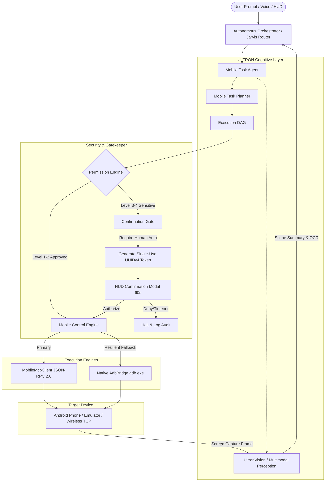
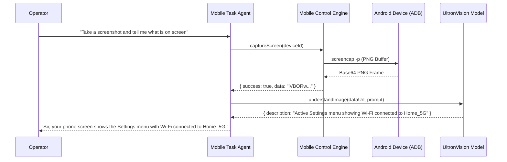

# ULTRON AI — Mobile Control Subsystem Architecture

## 1. Architectural Overview



---

## 2. Detailed Data Flow

### A. Action & Automation Flow
```
1. Operator submits goal: "Open YouTube on phone and search for quantum computing"
2. Intent Analysis:
   - Brain detects domain: "INTEGRATIONS"
   - Intent classified: "MOBILE_DEVICE_CONTROL"
   - Assigned Agent: AGENT_ROLES.MOBILE_DEVICE_AGENT ("mobile-device-agent")
3. Task Planning:
   - MobileTaskPlanner resolves "youtube" -> "com.google.android.youtube"
   - Plans 4 DAG stages:
     * Stage 1: mobile_launch_app ("com.google.android.youtube")
     * Stage 2: mobile_list_elements_on_screen (find search box)
     * Stage 3: mobile_type_keys ("quantum computing")
     * Stage 4: mobile_press_button ("ENTER")
4. Permission Evaluation:
   - Level 2 actions (launch non-sensitive app, type, enter) permitted under Autonomy Level 2
   - Sensitive package shield verifies YouTube is not financial or messaging
5. Pre-Action Assertion:
   - Control engine records foreground app before launch
6. Execution:
   - Dispatches via Mobile MCP or Native ADB
7. Post-Action Assertion:
   - Dumpsys query verifies foreground package equals "com.google.android.youtube"
8. Verification & Briefing:
   - Agent synthesizes natural JARVIS summary and updates HUD
```

---

## 3. Multimodal Perception Flow


