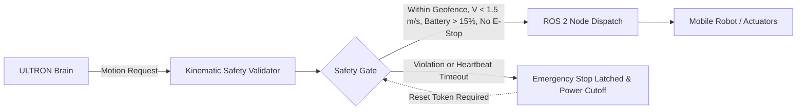
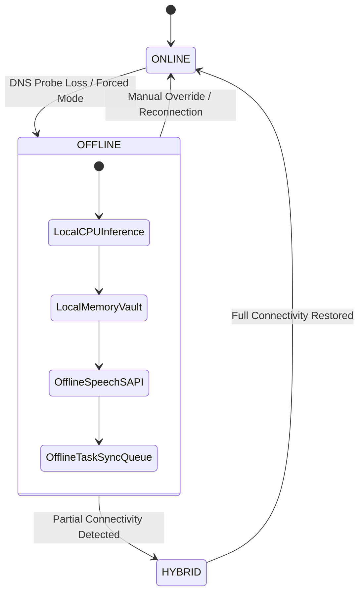

# ULTRON AI — Universal System Architecture Blueprint
## PROJECT CODENAME: ULTRON ETERNAL
### ONE BRAIN • COMPLETE AUTONOMY • CONTINUOUS EVOLUTION • 101% ACCOUNTABILITY

---

## 1. High-Level Architectural Topology

ULTRON AI is engineered as an enterprise-grade, resilient, multi-agent AI personal operating system inspired by the combined capabilities of IRON MAN'S JARVIS and MARVEL'S ULTRON. It decouples the core brain, background task execution, client interfaces, and physical hardware abstraction into distinct, independently scalable modules.

```
┌─────────────────────────────────────────────────────────────────────────────┐
│                             CLIENT INTERFACES                               │
│  ┌────────────────────────┐  ┌───────────────────────┐  ┌────────────────┐  │
│  │ Cyber-HUD ARC Reactor  │  │   Android Companion   │  │Windows Desktop │  │
│  │ (Render Web UI)        │  │   (Signed Pairing Hub)│  │(WMI & Screen)  │  │
│  └────────────────────────┘  └───────────────────────┘  └────────────────┘  │
└─────────────────────────────────────┬───────────────────────────────────────┘
                                      │ HTTPS / Supabase JWT Auth
                                      ▼
┌─────────────────────────────────────────────────────────────────────────────┐
│                          RENDER CLOUD ENVIRONMENT                           │
│                          (Workspace: ULTRON CORE)                           │
│                                                                             │
│   ┌─────────────────────────────────────────────────────────────────────┐   │
│   │                        ultron-ai-core                               │   │
│   │  ┌──────────────────────┐  ┌──────────────────┐  ┌────────────────┐ │   │
│   │  │   Express API Server │  │  Jarvis Router   │  │ Network Safety │ │   │
│   │  │   (server.js)        │  │ (jarvis-router)  │  │ (DNS-Pinned)   │ │   │
│   │  └──────────────────────┘  └──────────────────┘  └────────────────┘ │   │
│   │  ┌──────────────────────┐  ┌──────────────────┐  ┌────────────────┐ │   │
│   │  │  Brain Router & LLM  │  │ 18-Agent DAG/DLQ │  │ Cognitive Vault│ │   │
│   │  │  (core/brain-router) │  │ (orchestrator.js)│  │ (memory + docs)│ │   │
│   │  └──────────────────────┘  └──────────────────┘  └────────────────┘ │   │
│   │  ┌──────────────────────┐  ┌──────────────────┐  ┌────────────────┐ │   │
│   │  │  Connection Manager  │  │ 16-Domain Vault  │  │ Defensive Cyber│ │   │
│   │  │  (offline + online)  │  │ (knowledge-vault)│  │ (cyber-intel)  │ │   │
│   │  └──────────────────────┘  └──────────────────┘  └────────────────┘ │   │
│   │  ┌──────────────────────┐  ┌──────────────────┐  ┌────────────────┐ │   │
│   │  │  Privacy Geo Intel   │  │ Screen Observer  │  │ Kokoro am_onyx │ │   │
│   │  │  (geo-intel.js)      │  │ (credential OCR) │  │ (voice-engine) │ │   │
│   │  └──────────────────────┘  └──────────────────┘  └────────────────┘ │   │
│   └───────────────────────────────────┬─────────────────────────────────┘   │
│                                       │                                     │
│   ┌───────────────────────────────────▼─────────────────────────────────┐   │
│   │                      Background Task Worker                         │   │
│   │       (worker.js: Polled Queue with Distributed Leases & Quality)   │   │
│   └───────────────────────────────────┬─────────────────────────────────┘   │
└───────────────────────────────────────┼─────────────────────────────────────┘
                                        │
             ┌──────────────────────────┴──────────────────────────┐
             ▼                                                     ▼
┌─────────────────────────────────────────┐  ┌─────────────────────────────────┐
│           SUPABASE PROJECT              │  │      ROBOTICS & HARDWARE HAL    │
│     (Ref: opdjfhwepmcprbqojpat)         │  │   (robotics/robot-controller)   │
│                                         │  │                                 │
│  • Auth Engine (OAuth, Email, Sessions) │  │  • ROS 2 Standard Topic Adapters│
│  • PostgreSQL with Row Level Security   │  │  • Physical Safety Controller   │
│    - conversations & messages           │  │    - Latching Emergency Stop    │
│    - user_preferences                   │  │    - 3D Geofence Bounds         │
│    - memory_items (Vault)               │  │    - Velocity & Force Clamps    │
│    - agent_tasks & audit_events         │  │    - Battery Cutoff (<15%)      │
│  • Storage (ultron-private-documents)   │  │    - Heartbeat Dead-Man Switch  │
│                                         │  │  • Brain Export/Import Packages │
└─────────────────────────────────────────┘  └─────────────────────────────────┘
```

---

## 2. Subsystem Interfaces & Execution Pipelines

### 2.1 The Autonomous Request Lifecycle (11 Stages)
1. **Request Intake:** Authenticated caller sends request over TLS (`/api/jarvis/*` or `/api/chat`).
2. **Intent Analysis & Complexity Classification:** `BrainRouter` evaluates prompt complexity and determines if vision or specialized tools are required.
3. **Strategic Planning:** `chief-of-staff` agent generates task execution strategy.
4. **Task Decomposition & DAG Compilation:** Task is split into nodes with dependencies; Kahn's algorithm verifies graph is acyclic.
5. **Agent Selection:** Up to 18 specialized agents selected based on role capabilities.
6. **Tool Selection & Scope Validation:** Selected tools validated against allowlists (DNS pinning, security scopes).
7. **Permission Gate:** Sensitive operations checked against the 6-tier autonomy policy; confirmation requested if consequential.
8. **Safe Execution:** Tasks executed in parallel across independent DAG branches or isolated child-process sandboxes (256MB RAM cap).
9. **Quality Gate:** `autonomous-quality-gate.js` inspects output for completeness, formatting, and hallucination flags.
10. **State Persistence:** Output and audit events written to Supabase with atomic claim leases.
11. **Final Spoken & Visual Reporting:** Result formatted for Cyber-HUD and synthesized via Kokoro `am_onyx`.

---

## 3. Robotics Hardware Abstraction Layer (HAL)

ULTRON decouples cognitive decision-making from physical actuators via an independent Physical Safety Controller:



---

## 4. Offline / Online Dual-Mode Switching

The `ConnectionController` enables seamless state transitions without data loss:



---

## 5. Security & Governance Invariants

- **Fail-Closed Target Scope:** Cybersecurity scanning restricted to `localhost` and explicitly signed authorization scopes. Arbitrary domains rejected with `TARGET_OUT_OF_SCOPE_PROHIBITED`.
- **Privacy Location Gating:** Personal device tracking strictly requires a signed cryptographic consent token (15-min TTL) and non-bypassable audit logging. Covert tracking is rejected by design.
- **Hardware Headroom Guard:** AMD Ryzen 7 5700U host RAM protected by <85% utilization threshold with dynamic worker load shedding.
- **Physical Safety Latch:** Emergency stop in the robotics HAL is latched in software and independent from LLM prompting—no model hallucination can bypass the e-stop.
