```mermaid
flowchart TD
    subgraph ClientLayer ["Client & Interface Layer"]
        HUD["Living Energy Core HUD (Three.js / WebGL)"]
        VoiceClient["Web Audio / Web Speech API (Hindi/English/Hinglish)"]
        Companion["Windows Companion (C# .NET 8 / WinForms)"]
        FloatingCore["Floating Core Overlay (Stealth Capture Affinity 0x11)"]
    end

    subgraph SecurityBoundary ["Zero-Trust Security & Ingress Gate"]
        AuthMiddleware["Supabase Auth / HttpOnly JWT Cookie"]
        RateLimiter["IP / User Rate Limiter"]
        OpAuth["Cryptographic Operator Challenge (HMAC-SHA256)"]
        SSRF["Anti-SSRF Network Boundary (safeServiceBase)"]
    end

    subgraph CoreBrain ["ULTRON Central Brain & Intelligence"]
        BrainRouter["BrainRouter (Complexity & Dialect Classifier)"]
        HEI["Human Emotional Intelligence (51-Emotion Taxonomy)"]
        Personality["Adaptive Personality Engine (Kokoro am_onyx)"]
        PromptEngine["System Directive & Prompt Synthesizer"]
    end

    subgraph OrchestrationLayer ["Multi-Agent Orchestrator & Execution"]
        AgentMatrix["18-Agent Matrix & Agency Role Assembler"]
        DLQ["Dead-Letter Queue & Idempotency Fence"]
        TaskEngine["Durable Background Task Pipeline"]
        EvolutionEngine["Self-Evolution Engine (Audit / Patch / Rollback)"]
    end

    subgraph SubsystemsAndTools ["Tools, Bridges & Integrations"]
        Sandbox["Coding Sandbox (Docker / Fallback Isolation)"]
        DeviceHub["Device Hub & Pairing Manager"]
        AEC["Acoustic Echo Canceller & Snap Detector"]
        DiagramGen["Diagram Design Generator (Mermaid / SVG)"]
        Provenance["Content Provenance Analyzer (Not-Ai)"]
        PublicApis["Public APIs Catalog (Open-Meteo, CVE, OSM)"]
        Immich["Immich Private Media Connector"]
        SpeechAdapters["Neural Speech Gateway (OmniVoice / Chatterbox)"]
        WorldBridge["World Intelligence Bridge (God's Eye View)"]
    end

    subgraph DataAndInference ["Storage, Cloud & Local Inference"]
        SupabaseDB[("Supabase PostgreSQL (RLS / Isolated Schemas)")]
        LocalQuant["Local CPU Quantized Models (Cactus / Strata)"]
        CloudProviders["Cloud Provider Cascade (OpenRouter, Groq, Gemini)"]
    end

    ClientLayer --> SecurityBoundary
    SecurityBoundary --> CoreBrain
    CoreBrain --> OrchestrationLayer
    OrchestrationLayer --> SubsystemsAndTools
    SubsystemsAndTools --> DataAndInference
```

# ULTRON AI — Final System Architecture
## JARVIS × ULTRON Unified AI Operating System Architecture
### Monolithic Node.js ESM Core | Windows Companion | Supabase Auth & Memory | Render Cloud

---

---

## Core Architectural Invariants

1. **One Brain, Unified Identity:**
   ULTRON operates as a singular intelligence system. Features, agents, tools, and background workers share a unified cognitive model and consistent voice/personality.

2. **Defense in Depth & Zero-Trust Boundary:**
   Client inputs are untrusted by default. High-consequence operations (system updates, desktop execution, companion pairing) require cryptographically verified HMAC-SHA256 tokens bound to `ownerUserId` and payload digests.

3. **Pure CPU & Hardware-Aware Execution:**
   Engineered for an AMD Ryzen 7 5700U with 7 GB RAM. No CUDA required. High-intensity tasks leverage quantized local inference or asynchronous cloud cascades.

4. **Calibrated Forensic Transparency:**
   AI detection, provenance scoring, and threat modeling report calibrated uncertainty heuristics; the system never claims absolute forensic certainty.
